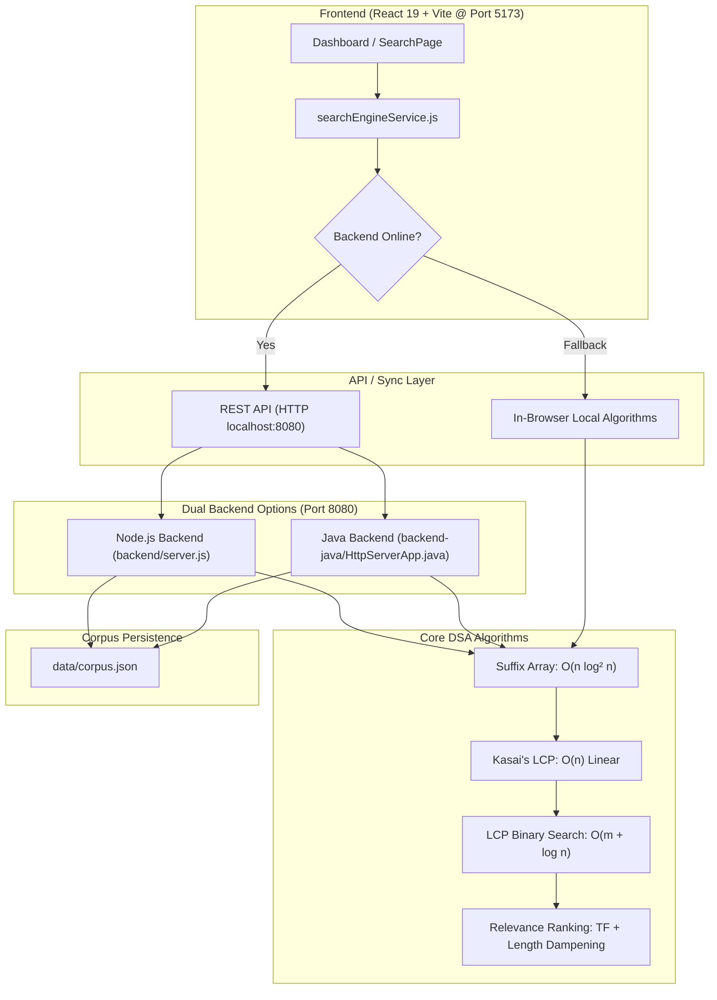

# Full-Text Search Engine on a Suffix-Array Index

**Course:** Data Structures & Algorithms - 3 (`25CS2103E`)  
**Team:** Team 16 • Section 10  
**Academic Year:** 2026–2027  
**Technology Stack:** React 19, Vite, Node.js REST Server, Java 21+ Virtual Threads, Kasai LCP Engine  

---

## 1. Project Overview

This project implements a high-performance **Full-Text Search Engine** designed for sub-millisecond retrieval across large text document collections. It replaces naive linear substring searches and pointer-heavy Suffix Trees with space-efficient **Suffix Arrays (SA)**, **Kasai's Longest Common Prefix (LCP) Array**, and **LCP-accelerated binary search**.

### Key Highlights
- **Sub-millisecond Search:** Reduces query complexity from $O(m \log n)$ to $O(m + \log n)$ using LCP skips.
- **Strictly Linear LCP Construction:** Kasai's algorithm guarantees $O(n)$ time using the prefix decrement invariant ($h \ge h - 1$).
- **Compact Memory Footprint:** Requires only $8n$ bytes of memory ($4n$ for SA + $4n$ for LCP), achieving an $\approx 75\text{–}80\%$ memory reduction over Suffix Trees.
- **Dual-Backend Support:** Fully functional with either a lightweight **Node.js REST server** or a **Java Virtual-Threaded server** on port `8080`.
- **Relevance Ranking Engine:** Combines term frequency (TF), logarithmic document length dampening, early-occurrence proximity, and title matches into a normalized score.

---

## 2. System Architecture



---

## 3. Core Algorithmic Foundations

### 1. Suffix Array Construction (`src/algorithms/suffixArray.js`)
- An array $SA$ storing starting positions of all suffixes of text $T$, sorted lexicographically.
- **Time Complexity:** $O(n \log^2 n)$ using prefix doubling.
- **Space Complexity:** $O(n)$ ($4n$ bytes using 32-bit integers).

### 2. Kasai's LCP Algorithm (`src/algorithms/kasaiLcp.js`)
- Constructs the Longest Common Prefix array between consecutive sorted suffixes in the Suffix Array.
- **Kasai's Invariant:** Traverses suffixes in order of text index $i = 0, \dots, n-1$. If $LCP(SA^{-1}[i], SA^{-1}[i] - 1) = h$, then for suffix $i + 1$, $h_{i+1} \ge h - 1$.
- **Amortized Analysis:** The common prefix length $h$ decreases by at most $1$ per step and cannot exceed $n$. Therefore, character comparisons are strictly bounded by $2n$.
- **Time Complexity:** $O(n)$ strictly linear time.

### 3. LCP-Accelerated Binary Search (`src/algorithms/lcpBinarySearch.js`)
- Standard binary search on $SA$ requires $O(m \log n)$ character comparisons.
- By utilizing adjacent LCP bounds between search boundaries $[L, R]$ and the midpoint suffix, already-matched prefix characters are skipped directly:
  $$\text{Skip Offset} = \min(LCP(P, SA[L]), LCP(P, SA[R]))$$
- **Time Complexity:** $O(m + \log n)$.

### 4. Relevance Ranking Formula (`src/services/searchEngineService.js`)
$$\text{Score} = \frac{\text{Term Frequency} \times 1.5}{\log_{10}(\max(10, |D|))} + \text{Title Bonus} + \text{Proximity Bonus}$$
- **Length Normalization:** Prevents massive documents from monopolizing rankings.
- **Title Bonus:** Adds $+2.0$ if the pattern directly appears in the document title.
- **Proximity Bonus:** Rewards matches appearing near the beginning of the text.

---

## 4. Asymptotic Complexity Comparison

| Algorithm / Structure | Index Build Time | Query Lookup Time | Memory Overhead | Substring Search |
|---|---|---|---|---|
| **Linear Scan (Naive)** | $O(1)$ (No index) | $O(n \cdot m)$ | $O(n)$ ($1\times$ raw text) | Supported |
| **Inverted Index** | $O(n)$ | $O(1)$ (Words only) | $O(n)$ ($2\times$–$3\times$) | Word-level only |
| **Suffix Tree (Ukkonen)** | $O(n)$ | $O(m)$ | $O(n)$ ($20n$–$40n$ bytes) | Full substring |
| **Suffix Array + Kasai LCP (Our Engine)** | $O(n \log^2 n)$ | **$O(m + \log n)$** | **$O(n)$ ($8n$ bytes total)** | **Full substring & prefix** |

---

## 5. REST API Specification (`http://localhost:8080`)

| Method | Endpoint | Description |
|---|---|---|
| `GET` | `/api/health` | Health status, document count, and runtime telemetry |
| `GET` | `/api/stats` | Asymptotic complexity metrics and memory footprint |
| `GET` | `/api/documents` | Retrieve all indexed corpus documents |
| `GET` | `/api/documents/{id}` | Retrieve a specific document by its ID |
| `POST` | `/api/documents` | Add and index a new text document |
| `DELETE` | `/api/documents/{id}` | Remove a document from the corpus |
| `POST` | `/api/documents/reset` | Reset corpus to initial 12 academic seed documents |
| `POST` | `/api/documents/reindex` | Trigger full reindexing across all corpus documents |
| `POST` | `/api/search` | Execute query (`SUBSTRING`, `PREFIX`, `PHRASE`) with ranking |
| `POST` | `/api/index/suffix-array` | Generate Suffix Array for string payload |
| `POST` | `/api/index/kasai-lcp` | Step-by-step Kasai LCP trace for educational review |
| `POST` | `/api/index/simulate-search` | Visual binary search simulation over Suffix Array |

---

## 6. How to Run the Project

### Prerequisites
- Node.js (v18+)
- Java 21+ (Optional, for running Java backend)

### Step 1: Start the Backend Server (Port 8080)

**Option A — Node.js Backend:**
```bash
npm run backend
```

**Option B — Java Backend:**
```powershell
cd backend-java
.\run.ps1
```

### Step 2: Start the Frontend UI (Port 5173)
```bash
npm run dev
```

Open `http://localhost:5173/` in your web browser.

### Step 3: Run Validation & Linter
```bash
# Run Oxlint (0 warnings, 0 errors verified)
npm run lint

# Production Build
npm run build
```

---

## 7. Faculty Presentation & Viva Cheat Sheet

1. **Why Suffix Arrays over Suffix Trees?**
   - Suffix Trees require multiple pointers per node, consuming $20\text{–}40\times$ more memory than the text itself. Suffix Arrays use simple contiguous 32-bit integers, requiring only $4n$ bytes with superior CPU cache locality.

2. **Why Kasai's algorithm over naive LCP construction?**
   - Naive adjacent suffix comparison takes $O(n^2)$ worst-case. Kasai's algorithm proves that common prefix length decreases by at most 1 between adjacent text positions, guaranteeing linear $O(n)$ time via amortized analysis.

3. **How does LCP accelerate binary search?**
   - In standard binary search, comparing the pattern with midpoint suffix takes $O(m)$, leading to $O(m \log n)$. Using precalculated LCP bounds skips already-verified matching prefixes, dropping the cost to $O(m + \log n)$.

4. **What is the purpose of the Sentinel character (`$`)?**
   - In multi-document collections, sentinels (e.g., `$` or `#`) delimit document boundaries so that a suffix from Document 1 cannot falsely spill over into Document 2.
